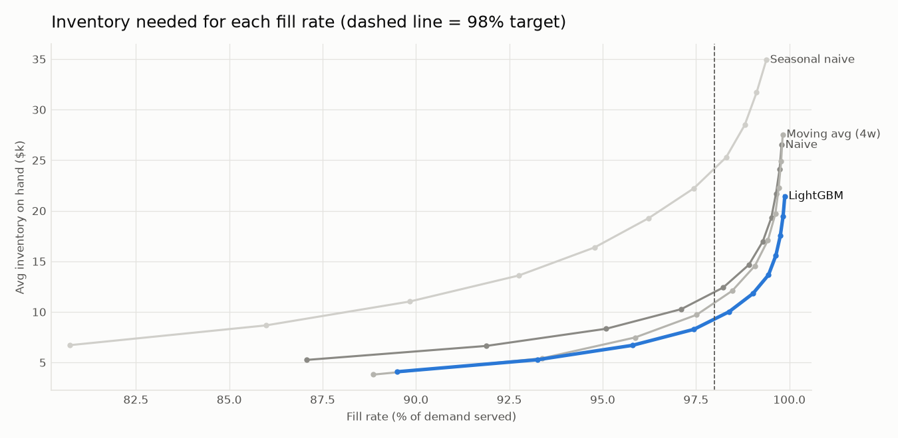
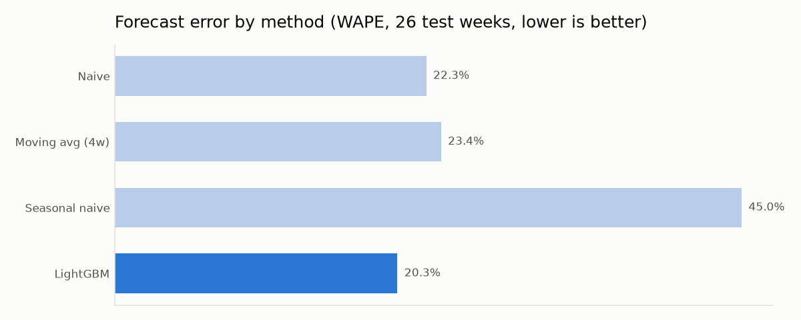
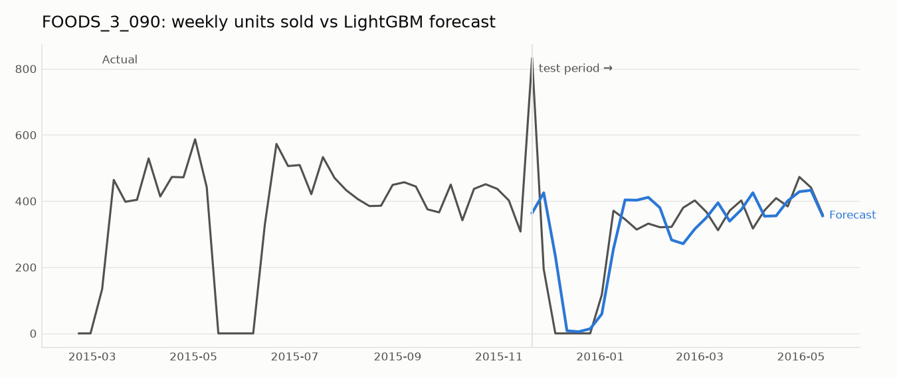

# Demand Forecasting and Inventory Planning (Walmart M5)

**Question:** Can a better weekly forecast let a grocery store hold less stock without running out more often?



## Key findings
Scope: 50 top-selling food SKUs at Walmart store CA_1. Backtested on the last 26 weeks (Nov 2015 to May 2016), which the model never saw during training or tuning.

1. **LightGBM cut forecast error to 20.3% WAPE**, against 22.3% for last-week naive and 23.4% for a 4-week moving average. That is a 9% relative improvement, with almost no bias (-0.4%).
2. **Better forecasts mean less safety stock.** To serve 98% of demand, the LightGBM-driven policy needs **$9.3k of average inventory, against $10.9k for the best simple method (15% less) and $12.0k for naive (22% less)**.
3. **Seasonal naive (same week last year) is a poor choice here.** It has 45% error and needs more than twice the inventory, because grocery demand shifts too much year to year.
4. **Recent sales and seasonality drive the model.** The top features are last week's sales, sales 52 weeks ago, week of year and recent volatility.

| | |
|---|---|
|  |  |

## Method
1. **Data:** daily unit sales were rolled up to Walmart weeks for the 50 highest-volume `FOODS_3` items at store `CA_1`, from 2013 to 2016. Weekly price, SNAP benefit days and event days were joined on.
2. **Forecasts** are one week ahead, using only information available at the time:
   - **Naive:** last week's sales.
   - **Moving average:** the last 4 weeks.
   - **Seasonal naive:** the same week last year.
   - **LightGBM:** one global model for all items, using lag, rolling and price features, plus SNAP days, events, week of year and item.
   - The LightGBM loss function (L1) was chosen on a separate 13-week validation window, not on the test set.
3. **Inventory policy:**
   - Weekly review with 1-week lead time, using an order-up-to level: `S = 2 × forecast + safety stock`.
   - Safety stock is calculated as `z × σ(forecast error) × √2`. The error spread σ is measured on the validation weeks.
   - Service targets follow **ABC classes**, based on each item's share of revenue: A = 98% (26 items), B = 95% (15), C = 90% (9).
4. **Simulation:** each method's policy is replayed week by week on the real test demand. Unmet demand counts as a lost sale. To compare methods fairly, safety stock is scaled from 0× to 2.5×, which traces the fill-rate vs inventory curve above. The methods are then compared at the same 98% fill rate.
5. **Self-checks** in the code: every method forecasts every test week, fill rates stay between 0 and 1, there's no negative stock, and every item has an ABC class.

## Outputs
| File | Contents |
|---|---|
| `output/accuracy.csv` | WAPE and bias by method |
| `output/inventory_summary.csv` | Fill rate, inventory, safety stock and stockouts by method |
| `output/tradeoff_curve.csv` | Points on the curve in the chart |
| `output/reorder_plan.csv` | **Per-SKU safety stock and order-up-to level**, i.e. what a planner would use |
| `output/feature_importance.csv` | LightGBM feature importance |

## Limitations
- **Sales are not the same as demand.** 9% of item-weeks show zero sales, including multi-week gaps for items that normally sell hundreds a week (16 of the 25 items that average 100+ units a week). These gaps are most likely stockouts, so real demand is understated. A next step would be to flag these weeks and exclude them from training.
- Holding cost, order cost and shelf capacity are not modelled. The policy optimises service against average stock value only.
- One store and 50 SKUs. The same code scales to the full M5 dataset (30,490 series).

## Run it
```bash
pip install -r requirements.txt
# download m5.zip (https://github.com/Nixtla/m5-forecasts/raw/main/datasets/m5.zip) and unzip into data/raw/
python forecast.py
```
The first run builds `data/weekly.csv` (about 1 min). Later runs reuse it.
